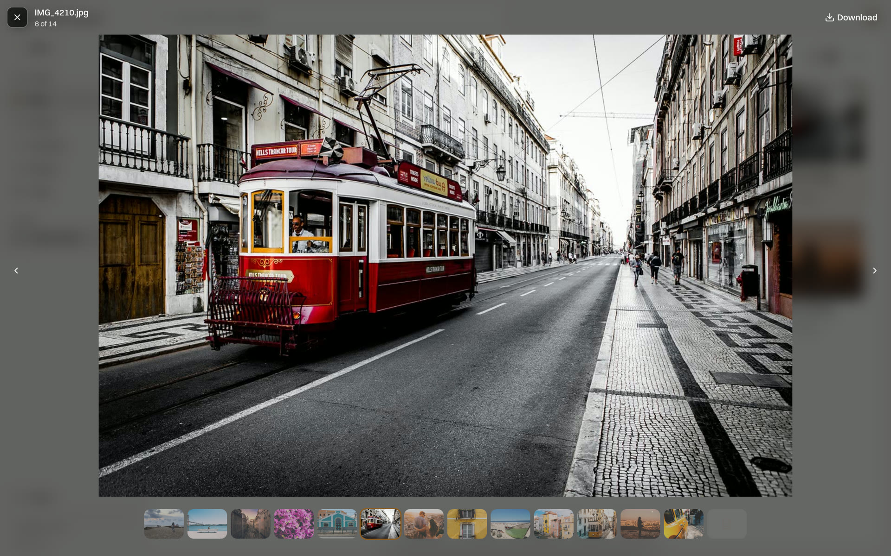
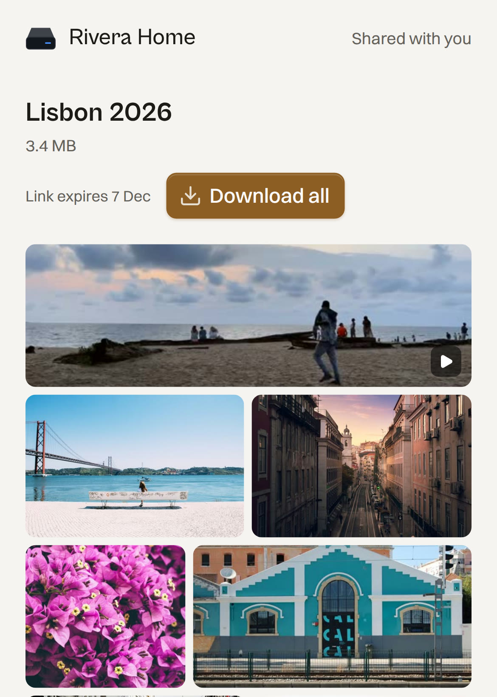
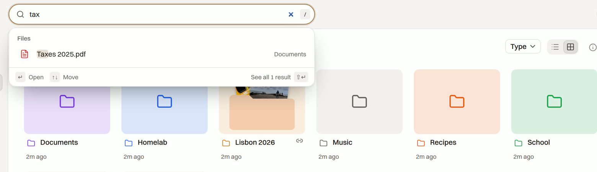
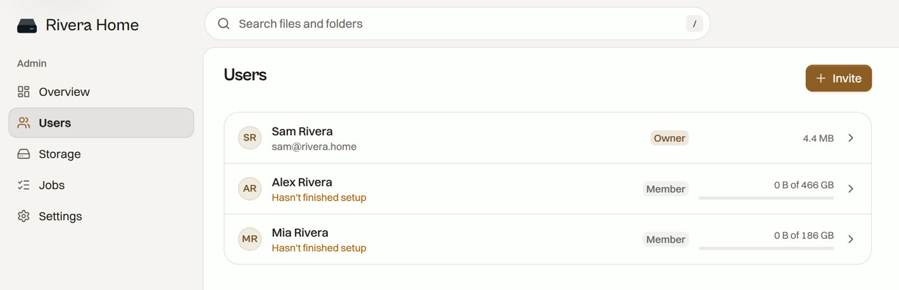
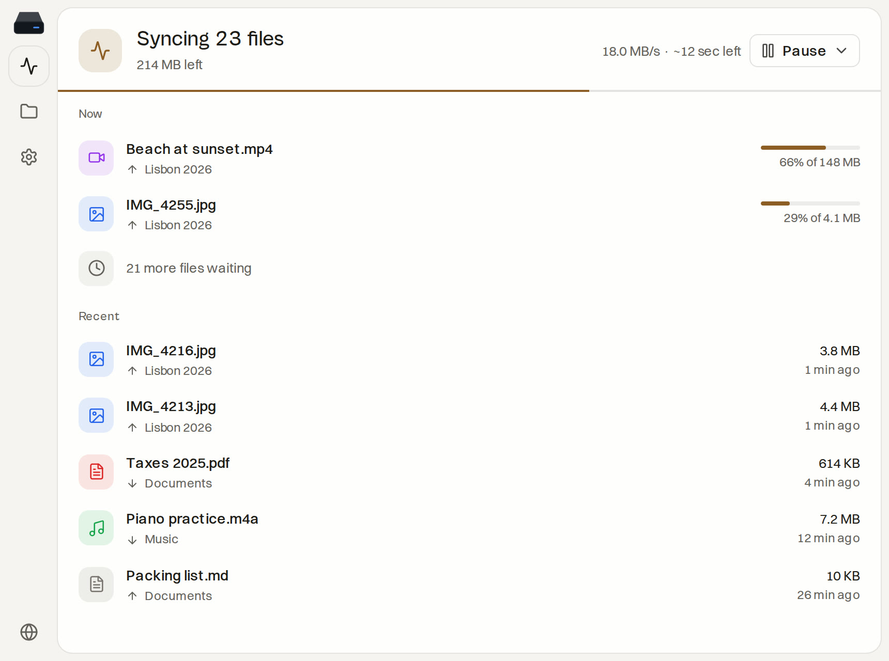

<div align="center">

<a href="https://itsmeares.github.io/staaash/"><picture><source media="(prefers-color-scheme: dark)" srcset="https://raw.githubusercontent.com/itsmeares/staaash/main/design/Banner/Staaash%20Banner-Dark.jpg"></picture></a>

<h3>Your own drive, on your own box.</h3>

<p>Free, open source and yours. No account with anyone, no monthly bill.</p>

<p>
<a href="https://itsmeares.github.io/staaash/"></a>&nbsp;
<a href="#get-started"></a>&nbsp;
<a href="#-desktop-app"></a>
</p>

<sub>The demo runs in your browser. Nothing you upload leaves your computer.</sub>

<p>
<a href="https://github.com/itsmeares/staaash/releases"></a>
<a href="https://github.com/itsmeares/staaash/blob/main/LICENSE"></a>
<a href="https://github.com/itsmeares/staaash/actions/workflows/ci.yml"></a>
</p>

</div>

<picture><source media="(prefers-color-scheme: dark)" srcset="https://raw.githubusercontent.com/itsmeares/staaash/main/design/Screenshots/lisbon-dark.jpg"></picture>

<table>
<tr><td width="50%"><picture><source media="(prefers-color-scheme: dark)" srcset="https://raw.githubusercontent.com/itsmeares/staaash/main/design/Screenshots/photo-dark.jpg"></picture></td><td width="50%" valign="middle"><h3>Open everything in the browser</h3><p>Photos (HEIC too), videos, music, PDFs and text open right away, on a laptop or a phone. No app to install for the people you share with.</p></td></tr>
<tr><td width="50%" valign="middle"><h3>Share a folder in two clicks</h3><p>Send a link with an end date, a password, or downloads turned off. Visitors need no account, and a photo folder opens as a gallery.</p></td><td width="50%"><picture><source media="(prefers-color-scheme: dark)" srcset="https://raw.githubusercontent.com/itsmeares/staaash/main/design/Screenshots/share-phone-crop-dark.jpg"></picture></td></tr>
<tr><td width="50%"><picture><source media="(prefers-color-scheme: dark)" srcset="https://raw.githubusercontent.com/itsmeares/staaash/main/design/Screenshots/search-crop-dark.jpg"></picture></td><td width="50%" valign="middle"><h3>Find anything as you type</h3><p>Search ignores capitals and accents, and matches folder names too. Type <code>tax</code> and <code>Taxes 2025.pdf</code> is there before you finish.</p></td></tr>
<tr><td width="50%" valign="middle"><h3>Room for the whole family</h3><p>Invite people and give each one a private space and a storage limit. Even the owner can't browse someone else's files in the app.</p></td><td width="50%"><picture><source media="(prefers-color-scheme: dark)" srcset="https://raw.githubusercontent.com/itsmeares/staaash/main/design/Screenshots/members-crop-dark.jpg"></picture></td></tr>
<tr><td width="50%"><picture><source media="(prefers-color-scheme: dark)" srcset="https://raw.githubusercontent.com/itsmeares/staaash/main/design/Screenshots/desktop-dark.jpg"></picture></td><td width="50%" valign="middle"><h3>Keep folders in sync</h3><p>The desktop app for Windows, macOS and Linux keeps a folder on your computer and your drive the same. Two-way, download-only or upload-only. It lives in the tray.</p></td></tr>
</table>

## Built not to lose your files

<table>
<tr>
<td width="33%" align="center"><h3>🔌</h3><b>Pull the plug</b><br>A move or upload never ends half done.</td>
<td width="33%" align="center"><h3>📂</h3><b>Plain folders</b><br>Your files are normal files. Copy them and go.</td>
<td width="33%" align="center"><h3>📦</h3><b>One box</b><br>The app, a worker and PostgreSQL. That's all.</td>
</tr>
</table>

<sub>Staaash is a drive, not a backup. Keep a separate copy of what matters.</sub>

## Get started

Pick your system. Each one takes a few minutes.

<details>
<summary><b>🐧 Linux or macOS, with Docker</b></summary>
<br>

Paste this. It downloads two files, makes a random database password, and starts Staaash.

```bash
mkdir staaash && cd staaash
curl -LO https://github.com/itsmeares/staaash/releases/latest/download/docker-compose.yml
curl -L https://github.com/itsmeares/staaash/releases/latest/download/example.env \
  | sed "s/^DB_PASSWORD=.*/DB_PASSWORD=$(openssl rand -hex 24)/" > .env
docker compose up -d
```

Open **http://localhost:2113** and create your account. On a server, use its address instead of `localhost`.

</details>

<details>
<summary><b>🪟 Windows, with Docker Desktop</b></summary>
<br>

In PowerShell:

```powershell
mkdir staaash; cd staaash
curl.exe -LO https://github.com/itsmeares/staaash/releases/latest/download/docker-compose.yml
curl.exe -L -o .env https://github.com/itsmeares/staaash/releases/latest/download/example.env
notepad .env
```

In Notepad, set `DB_PASSWORD` to a long mix of letters and numbers, save, and close. Then:

```powershell
docker compose up -d
```

Open **http://localhost:2113** and create your account.

</details>

<details>
<summary><b>🪟 Windows, without Docker</b></summary>
<br>

Download `Staaash-Server-…-win-x64.exe` from the [latest release](https://github.com/itsmeares/staaash/releases/latest) and run it. It sets up Staaash and its database as Windows services, then opens the page to create your account. See the [Windows server guide](https://github.com/itsmeares/staaash/wiki/Windows-Server).

</details>

### 💻 Desktop app

Keeps folders on your computer in sync with your drive. Needs a Staaash 2.0 server.

| Windows                                                                                                                                         | macOS                                                                 | Linux                                                                                                                                                                                        |
| ----------------------------------------------------------------------------------------------------------------------------------------------- | --------------------------------------------------------------------- | -------------------------------------------------------------------------------------------------------------------------------------------------------------------------------------------- |
| [Installer x64](https://github.com/itsmeares/staaash/releases/latest) · [Installer ARM64](https://github.com/itsmeares/staaash/releases/latest) | [Universal DMG](https://github.com/itsmeares/staaash/releases/latest) | [AppImage](https://github.com/itsmeares/staaash/releases/latest) · [DEB](https://github.com/itsmeares/staaash/releases/latest) · [RPM](https://github.com/itsmeares/staaash/releases/latest) |

<sub>The installers are not code signed yet. The <a href="https://github.com/itsmeares/staaash/wiki/Desktop-App">desktop app guide</a> shows how to open them the first time.</sub>

Want to reach your drive from outside the house? [Add HTTPS with your own domain](https://github.com/itsmeares/staaash/wiki/Reverse-Proxy).

<sub>2.0 is in release candidates until 2.0.0 is out. To try it now, use the <a href="https://github.com/itsmeares/staaash/releases">newest release candidate</a>.</sub>

## Guides

<table>
<tr>
<td width="33%" valign="top">🚀 <a href="https://github.com/itsmeares/staaash/wiki/Installation"><b>Installation</b></a><br>From nothing to your own drive, step by step.</td>
<td width="33%" valign="top">🔄 <a href="https://github.com/itsmeares/staaash/wiki/Updating"><b>Updating</b></a><br>Move to a new version without losing a thing.</td>
<td width="33%" valign="top">💾 <a href="https://github.com/itsmeares/staaash/wiki/Backup-and-Restore"><b>Backup and restore</b></a><br>Protect your files and practice getting them back.</td>
</tr>
<tr>
<td width="33%" valign="top">📁 <a href="https://github.com/itsmeares/staaash/wiki/Using-the-Drive"><b>Using the drive</b></a><br>Upload, find, preview and get things back.</td>
<td width="33%" valign="top">👪 <a href="https://github.com/itsmeares/staaash/wiki/User-Management"><b>Family and friends</b></a><br>Invite people and give each one a storage limit.</td>
<td width="33%" valign="top">❓ <a href="https://github.com/itsmeares/staaash/wiki/FAQ"><b>FAQ</b></a><br>Quick answers to the questions people ask first.</td>
</tr>
</table>

<p align="center"><a href="https://github.com/itsmeares/staaash/wiki">All guides →</a></p>

## Community

<table>
<tr>
<td width="33%" valign="top">💬 <a href="https://github.com/itsmeares/staaash/discussions"><b>Discussions</b></a><br>Ask a question, share an idea or show your setup.</td>
<td width="33%" valign="top">🐞 <a href="https://github.com/itsmeares/staaash/issues/new/choose"><b>Issues</b></a><br>Report a bug or ask for a feature.</td>
<td width="33%" valign="top">🔒 <a href="https://github.com/itsmeares/staaash/blob/main/.github/SECURITY.md"><b>Security</b></a><br>Found a security problem? Tell us privately.</td>
</tr>
</table>

Want to help build it? Start with [CONTRIBUTING.md](https://github.com/itsmeares/staaash/blob/main/.github/CONTRIBUTING.md). Writing about Staaash? Use the [brand kit](https://github.com/itsmeares/staaash/blob/main/design/README.md).

## AI-assisted development

Most of Staaash's application code and tests were written with AI coding tools. I direct the architecture, priorities, and product decisions. User-facing documentation is reviewed and finalized by me.

## License

AGPL-3.0. See [LICENSE](https://github.com/itsmeares/staaash/blob/main/LICENSE).
