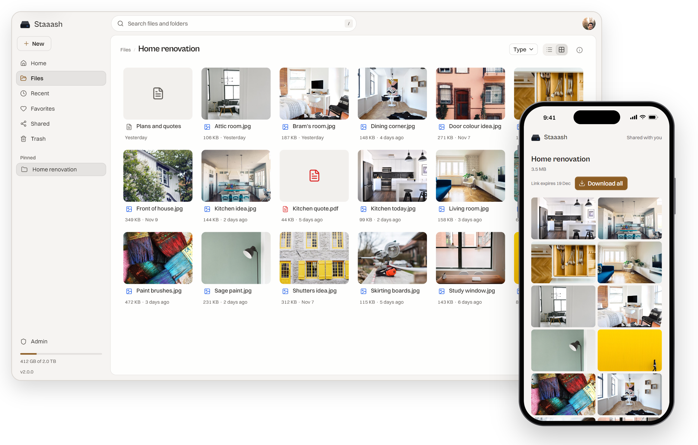
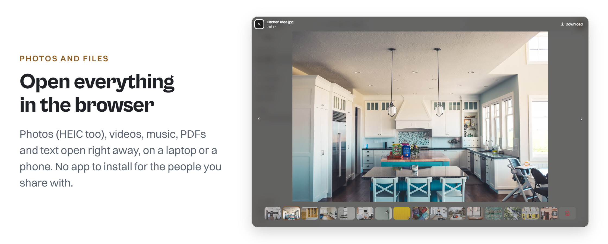
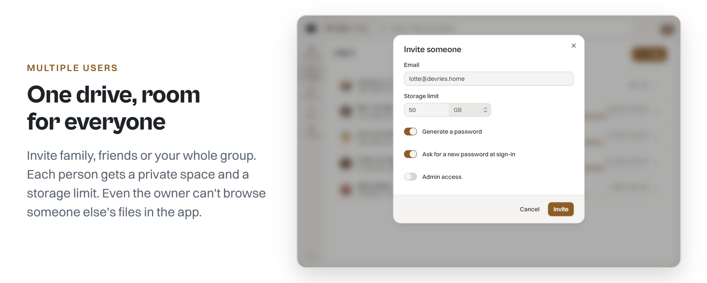
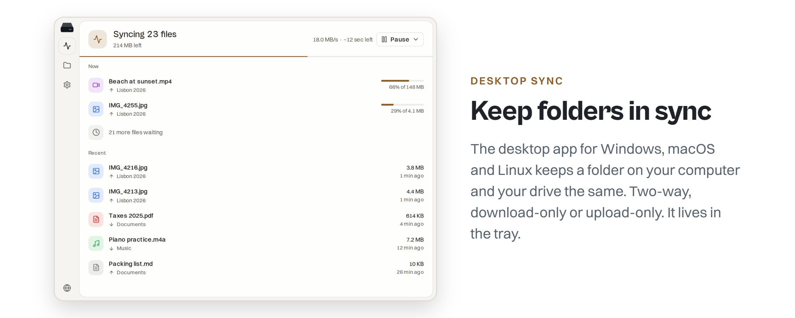
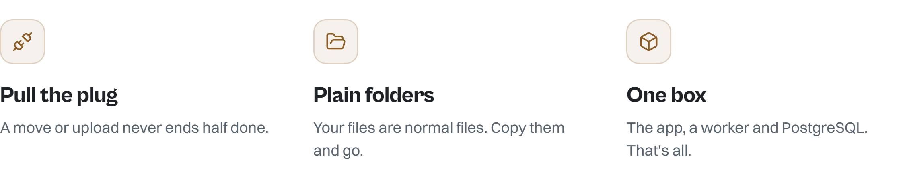

<div align="center">

<picture><source media="(prefers-color-scheme: dark)" srcset="https://raw.githubusercontent.com/itsmeares/staaash/main/design/Logo/Staaash%20Logo-Dark.png"></picture>

<h3>The drive for your homelab.</h3>

<p>
<a href="https://itsmeares.github.io/staaash/"></a>&nbsp;
<a href="#get-started"></a>&nbsp;
<a href="#desktop-app"></a>
</p>

<picture><source media="(prefers-color-scheme: dark)" srcset="https://raw.githubusercontent.com/itsmeares/staaash/main/design/Banner/Staaash%20README-Dark.webp"></picture>

<p>Free and open source. No cloud account, no monthly bill.</p>

<p>
<a href="https://github.com/itsmeares/staaash/releases"></a>
<a href="https://github.com/itsmeares/staaash/blob/main/LICENSE"></a>
<a href="https://github.com/itsmeares/staaash/actions/workflows/ci.yml"></a>
</p>

</div>

<!-- The phone sources say prefers-color-scheme:dark with no space on purpose. GitHub rewrites sources that match "prefers-color-scheme: dark" for people with a fixed theme, which would drop the width check. -->

<picture><source media="(max-width: 600px) and (prefers-color-scheme:dark)" srcset="https://raw.githubusercontent.com/itsmeares/staaash/main/design/Features/open-phone-dark.webp"><source media="(max-width: 600px)" srcset="https://raw.githubusercontent.com/itsmeares/staaash/main/design/Features/open-phone-light.webp"><source media="(prefers-color-scheme: dark)" srcset="https://raw.githubusercontent.com/itsmeares/staaash/main/design/Features/open-dark.webp"></picture>

<picture><source media="(max-width: 600px) and (prefers-color-scheme:dark)" srcset="https://raw.githubusercontent.com/itsmeares/staaash/main/design/Features/share-phone-dark.webp"><source media="(max-width: 600px)" srcset="https://raw.githubusercontent.com/itsmeares/staaash/main/design/Features/share-phone-light.webp"><source media="(prefers-color-scheme: dark)" srcset="https://raw.githubusercontent.com/itsmeares/staaash/main/design/Features/share-dark.webp"></picture>

<picture><source media="(max-width: 600px) and (prefers-color-scheme:dark)" srcset="https://raw.githubusercontent.com/itsmeares/staaash/main/design/Features/people-phone-dark.webp"><source media="(max-width: 600px)" srcset="https://raw.githubusercontent.com/itsmeares/staaash/main/design/Features/people-phone-light.webp"><source media="(prefers-color-scheme: dark)" srcset="https://raw.githubusercontent.com/itsmeares/staaash/main/design/Features/people-dark.webp"></picture>

<picture><source media="(max-width: 600px) and (prefers-color-scheme:dark)" srcset="https://raw.githubusercontent.com/itsmeares/staaash/main/design/Features/sync-phone-dark.webp"><source media="(max-width: 600px)" srcset="https://raw.githubusercontent.com/itsmeares/staaash/main/design/Features/sync-phone-light.webp"><source media="(prefers-color-scheme: dark)" srcset="https://raw.githubusercontent.com/itsmeares/staaash/main/design/Features/sync-dark.webp"></picture>

<br>

## Built not to lose your files

<picture><source media="(max-width: 600px) and (prefers-color-scheme:dark)" srcset="https://raw.githubusercontent.com/itsmeares/staaash/main/design/Features/promises-phone-dark.webp"><source media="(max-width: 600px)" srcset="https://raw.githubusercontent.com/itsmeares/staaash/main/design/Features/promises-phone-light.webp"><source media="(prefers-color-scheme: dark)" srcset="https://raw.githubusercontent.com/itsmeares/staaash/main/design/Features/promises-dark.webp"></picture>

> [!NOTE]
> These keep a crash or a move from breaking your files. A dead disk still can. Staaash is a drive, not a backup, so keep a copy somewhere else.

## Get started

Pick your system. Each one takes a few minutes.

<details>
<summary><b>Linux or macOS, with Docker</b></summary>
<br>

Paste this. It downloads two files, makes a random database password, and starts Staaash.

```bash
mkdir staaash && cd staaash
curl -LO https://github.com/itsmeares/staaash/releases/latest/download/docker-compose.yml
curl -L https://github.com/itsmeares/staaash/releases/latest/download/example.env \
  | sed "s/^DB_PASSWORD=.*/DB_PASSWORD=$(openssl rand -hex 24)/" > .env
docker compose up -d
```

Open **http://localhost:2113** and create your account right away. Until you do, anyone who can reach port 2113 can take the owner account. On a server, use its address instead of `localhost`.

</details>

<details>
<summary><b>Windows, with Docker Desktop</b></summary>
<br>

In PowerShell:

```powershell
mkdir staaash; cd staaash
curl.exe -LO https://github.com/itsmeares/staaash/releases/latest/download/docker-compose.yml
curl.exe -L -o .env https://github.com/itsmeares/staaash/releases/latest/download/example.env
notepad .env
```

In Notepad, set `DB_PASSWORD` to a long mix of letters and numbers, save, and close. Then:

```powershell
docker compose up -d
```

Open **http://localhost:2113** and create your account.

</details>

<details>
<summary><b>Windows, without Docker</b></summary>
<br>

Download `Staaash-Server-…-win-x64.exe` from the [latest release](https://github.com/itsmeares/staaash/releases/latest) and run it. It sets up Staaash and its database as Windows services, then opens the page to create your account. See the [Windows server guide](https://github.com/itsmeares/staaash/wiki/Windows-Server).

</details>

### Desktop app

Keeps folders on your computer in sync with your drive. Needs a Staaash 2.0 server.

| Windows                                                                                                                                         | macOS                                                                 | Linux                                                                                                                                                                                        |
| ----------------------------------------------------------------------------------------------------------------------------------------------- | --------------------------------------------------------------------- | -------------------------------------------------------------------------------------------------------------------------------------------------------------------------------------------- |
| [Installer x64](https://github.com/itsmeares/staaash/releases/latest) · [Installer ARM64](https://github.com/itsmeares/staaash/releases/latest) | [Universal DMG](https://github.com/itsmeares/staaash/releases/latest) | [AppImage](https://github.com/itsmeares/staaash/releases/latest) · [DEB](https://github.com/itsmeares/staaash/releases/latest) · [RPM](https://github.com/itsmeares/staaash/releases/latest) |

<sub>The installers are not code signed yet. The <a href="https://github.com/itsmeares/staaash/wiki/Desktop-App">desktop app guide</a> shows how to open them the first time.</sub>

Want to reach your drive from outside the house? [Add HTTPS with your own domain](https://github.com/itsmeares/staaash/wiki/Reverse-Proxy).

## Guides

- 🚀 **[Installation](https://github.com/itsmeares/staaash/wiki/Installation)**. From nothing to your own drive, step by step.
- 🔄 **[Updating](https://github.com/itsmeares/staaash/wiki/Updating)**. Move to a new version without losing a thing.
- 💾 **[Backup and restore](https://github.com/itsmeares/staaash/wiki/Backup-and-Restore)**. Protect your files and practice getting them back.
- 📁 **[Using the drive](https://github.com/itsmeares/staaash/wiki/Using-the-Drive)**. Upload, find, preview and get things back.
- 👪 **[Family and friends](https://github.com/itsmeares/staaash/wiki/User-Management)**. Invite people and give each one a storage limit.
- ❓ **[FAQ](https://github.com/itsmeares/staaash/wiki/FAQ)**. Quick answers to the questions people ask first.

[All guides →](https://github.com/itsmeares/staaash/wiki)

## Community

- 💬 **[Discussions](https://github.com/itsmeares/staaash/discussions)**. Ask a question, share an idea or show your setup.
- 🐞 **[Issues](https://github.com/itsmeares/staaash/issues/new/choose)**. Report a bug or ask for a feature.
- 🔒 **[Security](https://github.com/itsmeares/staaash/blob/main/.github/SECURITY.md)**. Found a security problem? Tell us privately.

Want to help build it? Start with [CONTRIBUTING.md](https://github.com/itsmeares/staaash/blob/main/.github/CONTRIBUTING.md). Writing about Staaash? Use the [brand kit](https://github.com/itsmeares/staaash/blob/main/design/README.md).

## AI-assisted development

Most of Staaash's application code and tests were written with AI coding tools. I direct the architecture, priorities, and product decisions. User-facing documentation is reviewed and finalized by me.

## License

AGPL-3.0. See [LICENSE](https://github.com/itsmeares/staaash/blob/main/LICENSE).
