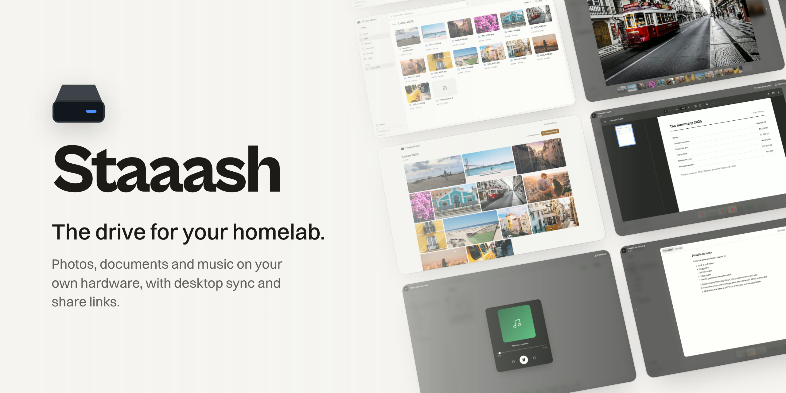
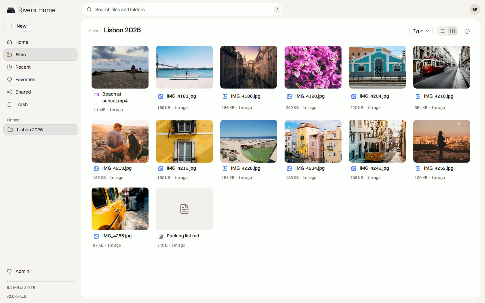
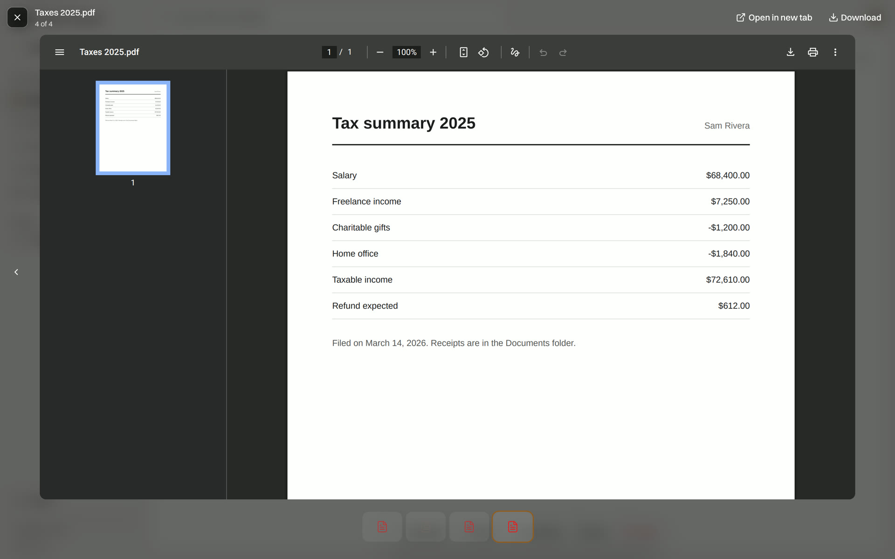
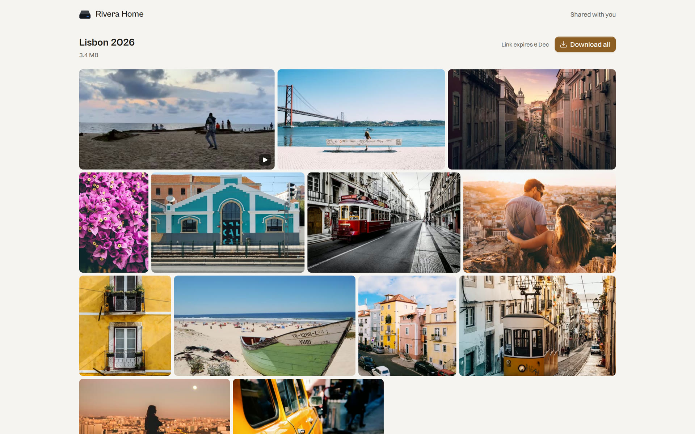

<div align="center">
<a href="https://itsmeares.github.io/staaash/">
  <picture>
    <source media="(prefers-color-scheme: dark)" srcset="https://raw.githubusercontent.com/itsmeares/staaash/main/design/Banner/Staaash%20Banner-Dark.jpg">
    
  </picture>
</a>

[](https://github.com/itsmeares/staaash/blob/main/LICENSE)
[](https://github.com/itsmeares/staaash/releases)
[](https://github.com/itsmeares/staaash/pkgs/container/staaash)
[](https://github.com/itsmeares/staaash/actions/workflows/ci.yml)

**[Try the demo](https://itsmeares.github.io/staaash/)** · **[Get started](#get-started)** · **[Desktop app](#desktop-app)**

</div>

Staaash is a drive you run yourself. Your photos, documents, and music live on your own disk, and you reach them from a browser, a desktop app that syncs folders, or a link you send to someone else. It runs from one Docker Compose file with PostgreSQL and a disk, and it is made for one person, a family, or a small group.

The [demo](https://itsmeares.github.io/staaash/) runs entirely in your browser, so nothing you upload leaves your computer.

<table>
  <tr>
    <td colspan="2">
      <picture>
        <source media="(prefers-color-scheme: dark)" srcset="https://raw.githubusercontent.com/itsmeares/staaash/main/design/Screenshots/lisbon-dark.jpg">
        
      </picture>
    </td>
  </tr>
  <tr>
    <td width="50%">
      <picture>
        <source media="(prefers-color-scheme: dark)" srcset="https://raw.githubusercontent.com/itsmeares/staaash/main/design/Screenshots/pdf-dark.jpg">
        
      </picture>
    </td>
    <td width="50%">
      <picture>
        <source media="(prefers-color-scheme: dark)" srcset="https://raw.githubusercontent.com/itsmeares/staaash/main/design/Screenshots/share-dark.jpg">
        
      </picture>
    </td>
  </tr>
</table>

## Why Staaash

- **Your files stay normal files.** Staaash keeps each file on your disk at a readable path that matches the folders you see in the app. You can read, copy, or back up that folder without Staaash.
- **It is built not to lose data.** Uploads, renames, moves, and deletes go through a journal in PostgreSQL. After a crash or a power cut, Staaash finishes or rolls back each change that was in progress. When it cannot tell what happened, it keeps every byte and stops for you to look.
- **One box to run.** The app, a background worker, and PostgreSQL. No Redis, no object storage, no other services.
- **Open what you keep.** Photos (HEIC too), videos, music, PDFs, and text files open right in the browser, on a laptop or a phone.
- **Sync with your computer.** The desktop app for Windows, macOS, and Linux syncs folders two-way, download-only, or upload-only.
- **Share with anyone.** Send a link to a file or a folder, with an expiry date, a password, or downloads turned off. Visitors do not need an account.
- **Room for the family.** Invite members and give each one a storage limit. The app keeps members' private files out of the owner's view, though whoever runs the server can still read its disk.
- **Big uploads finish.** Large uploads resume where they stopped, and every file is checked against its checksum before it is saved.
- **Find things fast.** Search ignores case and accents and matches folder names in the path. Deleted files wait in the trash until you restore them or the trash clears.
- **Build on it.** A [documented API](https://github.com/itsmeares/staaash/blob/main/apps/web/openapi.json) covers files, folders, uploads, shares, and sync.

## What Staaash is not

> [!IMPORTANT]
> Staaash is a file drive, not a backup system. Keep an independent backup of important files and test that you can restore it.

- It does not edit documents, and it has no calendar, contacts, or chat. It is a drive.
- It is made for a person, a family, or a small group, not a whole company.

## Get started

### Requirements

- Docker with Compose Plugin
- Linux AMD64 or ARM64 host

Download the current release files into an empty directory:

- [docker-compose.yml](https://github.com/itsmeares/staaash/releases/latest/download/docker-compose.yml)
- [example.env](https://github.com/itsmeares/staaash/releases/latest/download/example.env)

Then:

1. Rename `example.env` to `.env`.
2. Set `DB_PASSWORD` to a long, unique alphanumeric value. Change `UPLOAD_LOCATION` or `DB_DATA_LOCATION` if you need different host paths.
3. Start the stack:

   ```console
   docker compose up -d
   ```

4. Open [http://localhost:2113](http://localhost:2113). The first account becomes the owner and an admin.

The release files are the supported installation path. Files on `main` may contain unreleased changes.

To try Staaash 2.0, download `docker-compose.yml` and `example.env` from the [v2.0.0-rc.8 release](https://github.com/itsmeares/staaash/releases/tag/v2.0.0-rc.8) instead. Follow the same steps above. The release files select the matching server version. Back up your database and files together before upgrading an existing installation.

### Windows server

To run the server on Windows Server 2019 or newer, or Windows 10 or 11, without Docker, download the [v2.0.0-rc.8 server installer](https://github.com/itsmeares/staaash/releases/download/v2.0.0-rc.8/Staaash-Server-2.0.0-rc.8-win-x64.exe). It installs the web app, the worker, and PostgreSQL as Windows services. See [Windows Server](https://github.com/itsmeares/staaash/wiki/Windows-Server).

### Desktop app

The desktop app keeps folders on your computer in sync with your drive and lives in the tray. It needs a Staaash 2.0 server or newer. Download the [v2.0.0-rc.8 release candidate](https://github.com/itsmeares/staaash/releases/tag/v2.0.0-rc.8) for your system:

| System         | x64                                                                                                                              | ARM64                                                                                                                            |
| -------------- | -------------------------------------------------------------------------------------------------------------------------------- | -------------------------------------------------------------------------------------------------------------------------------- |
| Windows        | [Installer x64](https://github.com/itsmeares/staaash/releases/download/v2.0.0-rc.8/Staaash-Desktop-2.0.0-rc.8-win-x64.exe)       | [Installer ARM64](https://github.com/itsmeares/staaash/releases/download/v2.0.0-rc.8/Staaash-Desktop-2.0.0-rc.8-win-arm64.exe)   |
| macOS          | [Universal DMG](https://github.com/itsmeares/staaash/releases/download/v2.0.0-rc.8/Staaash-Desktop-2.0.0-rc.8-mac-universal.dmg) | [Universal DMG](https://github.com/itsmeares/staaash/releases/download/v2.0.0-rc.8/Staaash-Desktop-2.0.0-rc.8-mac-universal.dmg) |
| Linux AppImage | [Installer x64](https://github.com/itsmeares/staaash/releases/download/v2.0.0-rc.8/Staaash-Desktop-2.0.0-rc.8-x86_64.AppImage)   | [Installer ARM64](https://github.com/itsmeares/staaash/releases/download/v2.0.0-rc.8/Staaash-Desktop-2.0.0-rc.8-arm64.AppImage)  |
| Linux DEB      | [Installer x64](https://github.com/itsmeares/staaash/releases/download/v2.0.0-rc.8/Staaash-Desktop-2.0.0-rc.8-amd64.deb)         | [Installer ARM64](https://github.com/itsmeares/staaash/releases/download/v2.0.0-rc.8/Staaash-Desktop-2.0.0-rc.8-arm64.deb)       |
| Linux RPM      | [Installer x64](https://github.com/itsmeares/staaash/releases/download/v2.0.0-rc.8/Staaash-Desktop-2.0.0-rc.8-x86_64.rpm)        | [Installer ARM64](https://github.com/itsmeares/staaash/releases/download/v2.0.0-rc.8/Staaash-Desktop-2.0.0-rc.8-aarch64.rpm)     |

The installers are not code signed. On Windows, if SmartScreen blocks the installer, click More info, then Run anyway. On macOS, if the first launch is blocked, open System Settings, then Privacy & Security, and click Open Anyway.

The app checks GitHub for a new version when it starts and every six hours. Windows and Linux update themselves. On macOS the app tells you when a new version is ready to download.

## Learn more

- [Guides](https://github.com/itsmeares/staaash/wiki): install, configure, update, and run Staaash.
- [Backup and restore](https://github.com/itsmeares/staaash/wiki/Backup-and-Restore): protect your files and practice recovery.
- [Reverse proxy](https://github.com/itsmeares/staaash/wiki/Reverse-Proxy): put Staaash behind a domain with HTTPS.
- [Release notes](https://github.com/itsmeares/staaash/releases): check changes before upgrading.
- [Architecture](https://github.com/itsmeares/staaash/blob/main/docs/architecture.md): how Staaash stores and protects files.
- [Brand kit](https://github.com/itsmeares/staaash/blob/main/design/README.md): logos, colors, and screenshots for writing about Staaash.

## Community

- Ask questions, suggest ideas, and share feedback in [GitHub Discussions](https://github.com/itsmeares/staaash/discussions).
- Report bugs and request features through the issue tracker.
- Read [CONTRIBUTING.md](https://github.com/itsmeares/staaash/blob/main/.github/CONTRIBUTING.md) before changing the code.
- Report security problems privately through the [security policy](https://github.com/itsmeares/staaash/blob/main/.github/SECURITY.md).

## AI-assisted development

Most of Staaash's application code and tests were written with AI coding tools. I direct the architecture, priorities, and product decisions. User-facing documentation is reviewed and finalized by me.

## License

AGPL-3.0. See [LICENSE](https://github.com/itsmeares/staaash/blob/main/LICENSE).
