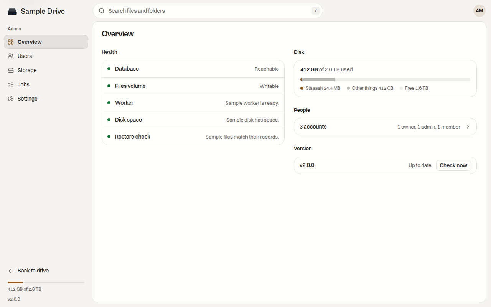
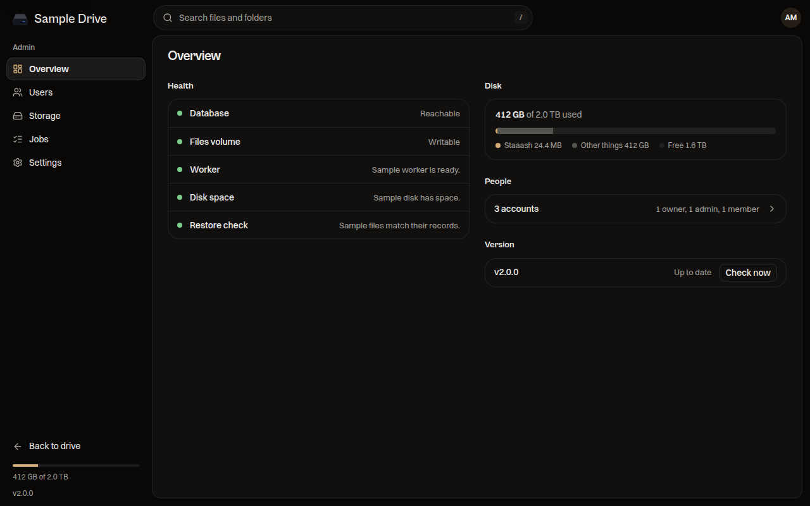
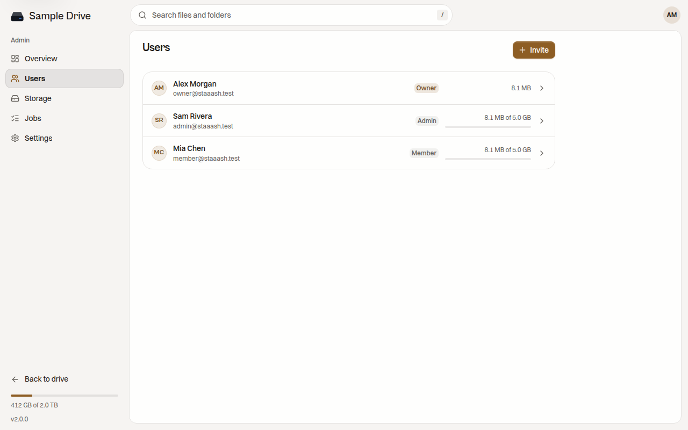
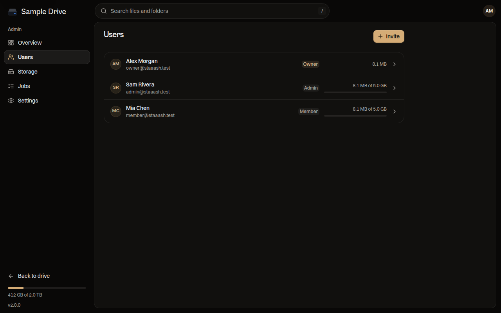
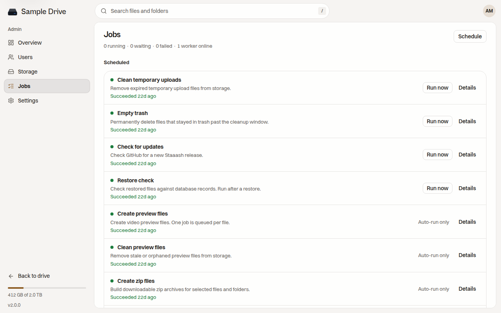
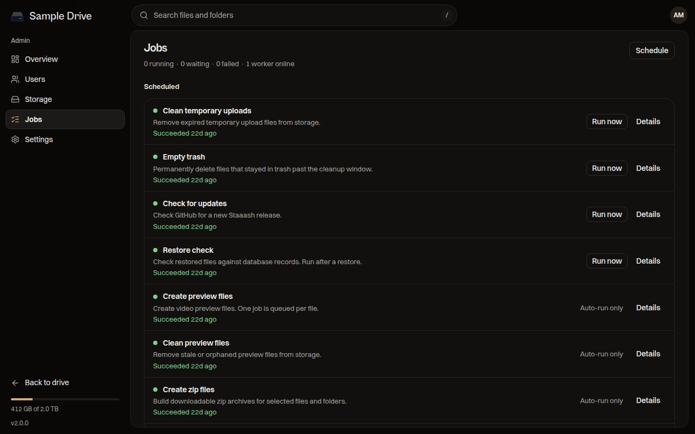
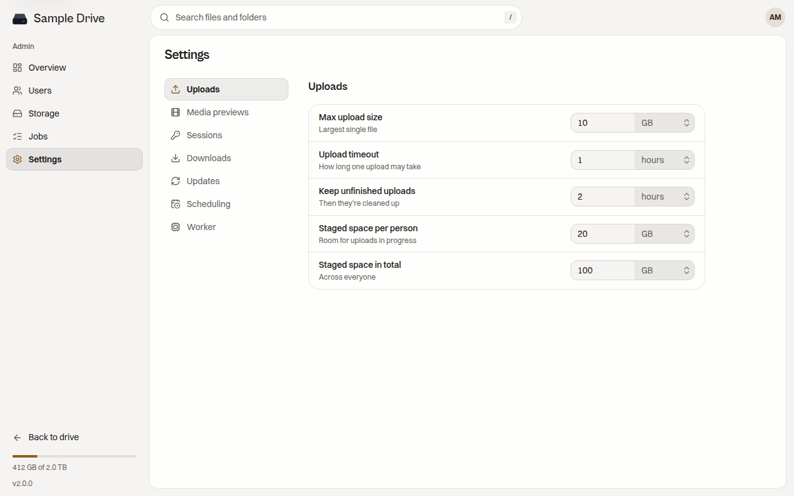
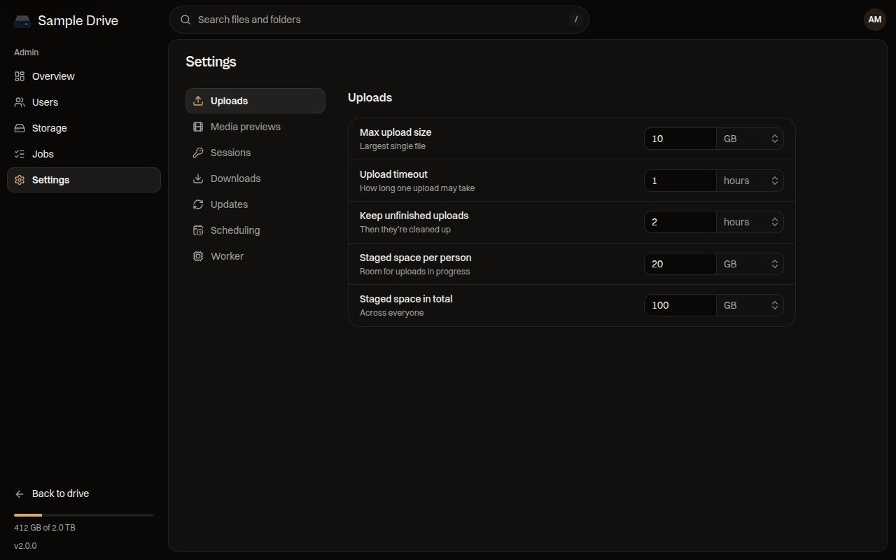

The admin area is where you check that your drive is healthy. Open it from the sidebar. The owner is the account that set up the instance, and only the owner can change things here. A person with **Admin access** can look but not change anything. See [User Management](/docs/user-management/).

Being the owner means you run the box. It does not mean you can read other people's files. Members stay private.

The admin area has five screens: Overview, Users, Jobs, Maintenance and Settings.

:::note[Coming in v2.1.0]
On v2.0, the menu has **Storage** in place of **Maintenance**, and failed jobs show in an **Activity** list under the jobs.
:::

## Overview

This is your daily check. It shows:

- **Needs attention.** Anything to act on, such as a storage change to review, jobs that gave up, or someone close to their storage limit.
- **Counts.** People, files, folders and open share links.
- **Space.** How full the disk is, and how much each person uses.
- **Health.** Is the database reachable? Is the files folder writable? Is the worker running? Does the disk have space? Do the files on disk match what the database remembers (the restore check)? The last line is the version you run. Press **Check now** to look for a new one.

If a health line shows a problem, read [Troubleshooting](/docs/troubleshooting/).

## Users

The list of people, their role, and how much storage each person uses. Press **Invite** to add someone. Press a person to change their name, email, role or storage limit, or to reset their password. See [User Management](/docs/user-management/) for each step.

## Jobs

Jobs are tasks the worker does in the background. Each row says when the job last ran or runs next. If no worker is online, a warning shows at the top, and previews and cleanup stop until the worker is back.

| Job                     | What it does                                                          | Run by hand?   |
| ----------------------- | --------------------------------------------------------------------- | -------------- |
| Clean temporary uploads | Removes leftovers of unfinished uploads.                              | Yes            |
| Empty trash             | Permanently deletes files that stayed in trash too long.              | Yes            |
| Check for updates       | Looks for a new Staaash release.                                      | Yes            |
| Restore check           | Compares files on disk with the database. Run it after a restore.     | Yes            |
| Create preview files    | Makes video preview files.                                            | Automatic only |
| Clean preview files     | Removes old preview files.                                            | Automatic only |
| Clean zip files         | Removes old zip files.                                                | Automatic only |
| Read words in files     | Reads the text inside files for search, and scans pages without text. | Automatic only |

Press **Details** to see a job's latest runs. Press a run to see each step it took. When runs fail, the row shows how many. Press that count to open the failed runs and **Retry** or **Dismiss** each one, or all at once. A failed preview names whose file it was, not the file, and it never stops the file itself from working.

## Maintenance

One line per check, each with one button.

- **Storage changes.** A file move, rename or delete is written down before it happens, so a crash cannot lose a file. If one stopped halfway, press **Review** to choose what to keep. See [Storage Check](/docs/storage-check/).
- **Restore check.** Compares files on disk with the database. Press **Run** after a restore.

## Settings

Upload limits, previews, sign-in time, update checks and more. Every setting is explained in [Configuration](/docs/configuration/).
