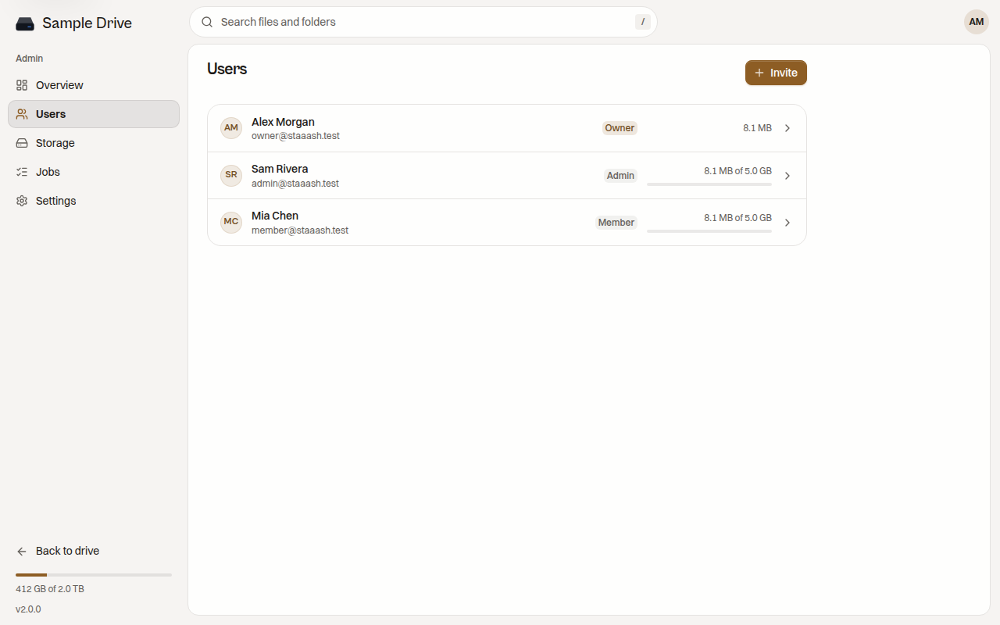
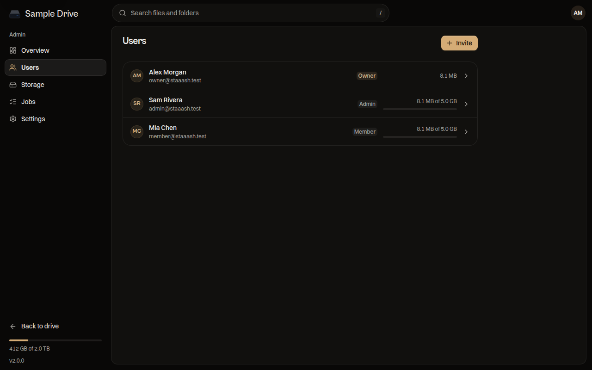

You decide who can use your drive. This page is for the owner.

## The roles

| Role   | What they can do                                                                                                                                                                                                                                   |
| ------ | -------------------------------------------------------------------------------------------------------------------------------------------------------------------------------------------------------------------------------------------------- |
| Owner  | The account that set up the instance. Runs the admin area.                                                                                                                                                                                         |
| Admin  | A person the owner gave **Admin access**. They can look at Overview, Users, Storage and Jobs, but they cannot change anything. Settings and every change still need the owner. Give it only to people you trust to see everyone's names and usage. |
| Member | A normal person. Has their own files, shares and settings.                                                                                                                                                                                         |

Everyone has a private space. The owner cannot read a member's files by being the owner.

## Invite someone

1. Open **Admin**, then **Users**, then press **Invite**.
2. Type their email.
3. Optional: set a **Storage limit**. Leave it empty for no limit.
4. Pick a password. Either type one, or choose **Generate a password**.
5. Optional: turn on **Ask for a new password at sign-in**, so they pick their own after the first sign-in.
6. Optional: turn on **Admin access**.
7. Press **Invite**.

Staaash shows the sign-in address, the email and the password **once**. Copy it and send it to them with a way you trust. Staaash does not send email, so you must give it to them yourself.

With [single sign-on](/docs/single-sign-on/), the invite form has a **Signs in with** switch with your provider's name, such as **Signs in with Pocket ID**. Keep it on, and Staaash shows a one-time invite link instead of a password.

## Change someone

Press a person in the list. You can change:

- their name and email
- their role
- their storage limit

## Storage limits

A limit stops a person from storing more than it. The list shows each person's use, for example "8.1 MB of 5.0 GB". Raise a limit any time. If you lower it below what they already use, they keep their files but cannot upload more until they free space.

## Reset a password

1. Press the person, then **Reset password** under **Signed in**.
2. Choose a new temporary password, or let Staaash make one.
3. Send it to them.

Resetting signs them out everywhere and deletes their keys. You can also sign out a single device, or delete a single key, from the same screen.

## Sign-in time

By default people stay signed in for a while and then sign in again. Change the time under admin **Settings**, **Sessions**. See [Configuration](/docs/configuration/).

## Removing a person

The admin screens have no button to delete an account. If someone should lose access today:

1. If they sign in with single sign-on, remove them at your provider first. With `OIDC_AUTO_REGISTER=true`, that is the only thing that stops them from getting a new account.
2. If they are connected, open them in **Admin → Users** and press **Disconnect** next to the provider's name.
   If they never used their invite link, press **New invite link** instead and don't send it. That cancels the old link.
3. If passwords are on, reset their password and keep the new password to yourself.
4. Sign out their devices and delete their keys under **Signed in**. A password reset already does this.

Ask in [GitHub Discussions](https://github.com/itsmeares/staaash/discussions) if you need the account fully removed.
