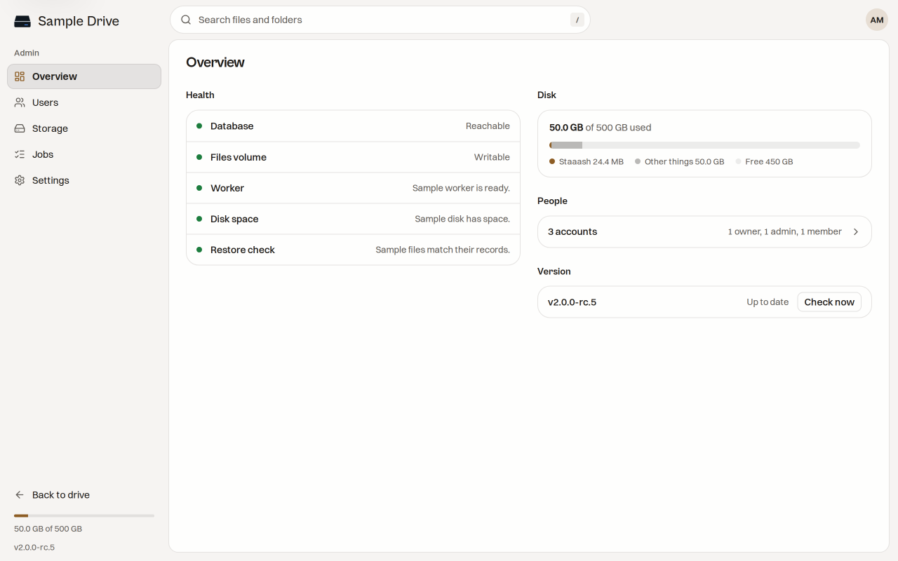
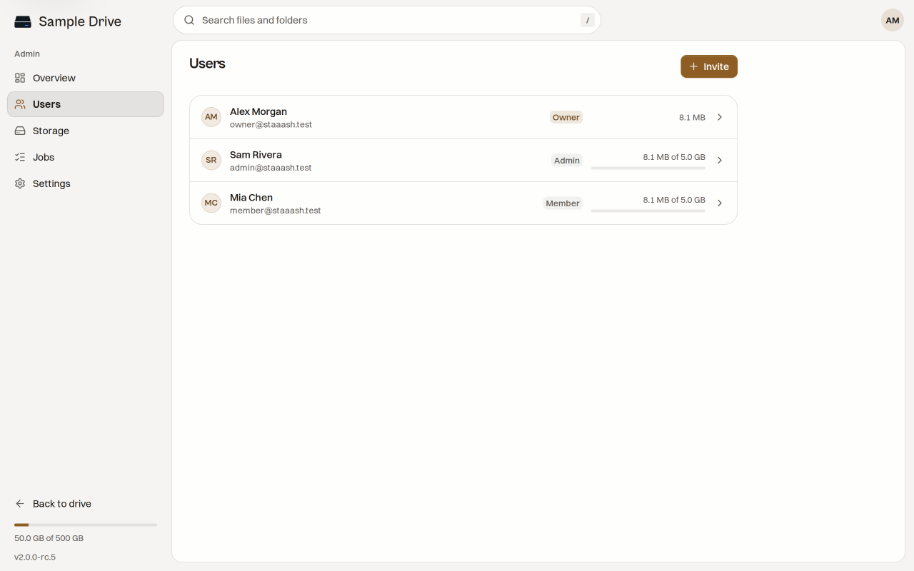
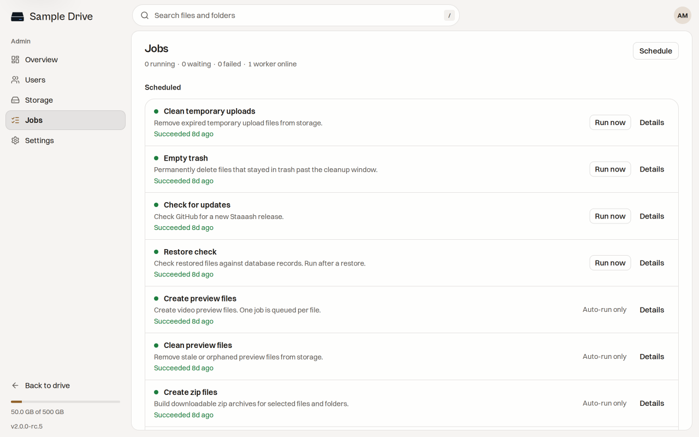
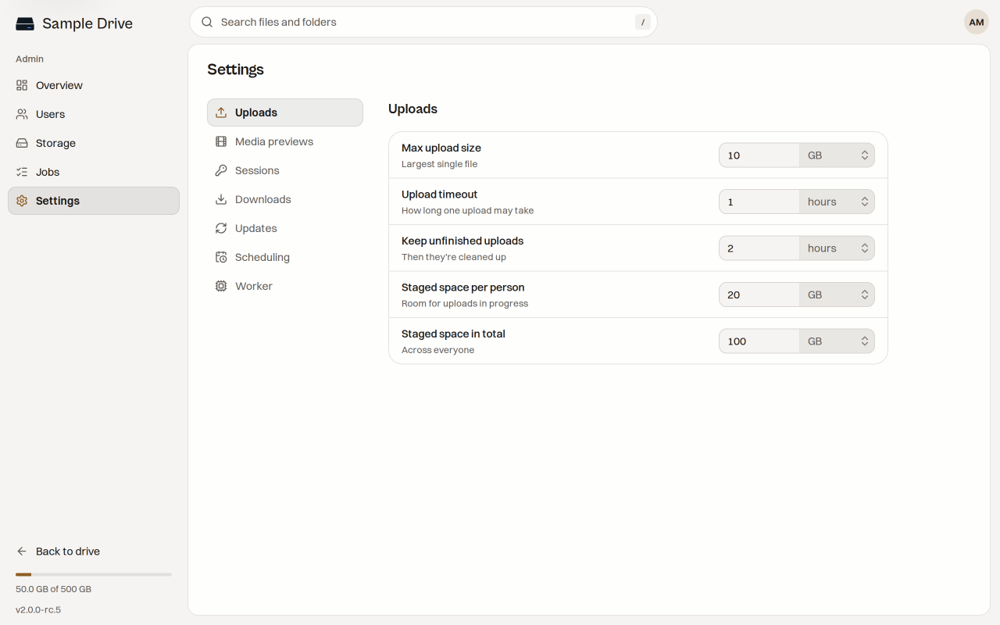

# Admin Guide

The admin area is where you check that your drive is healthy. Open it from the sidebar. The owner is the account that set up the instance, and the owner is the one who can use these screens.

Being the owner means you run the box. It does not mean you can read other people's files. Members stay private.

The admin area has five screens.

## Overview

This is your daily check. It shows:

- **Health.** Is the database reachable? Is the files folder writable? Is the worker running? Does the disk have space? Do the files on disk match what the database remembers (the restore check)?
- **Disk.** How much of the disk is used, how much of that is Staaash, and how much is free.
- **People.** How many accounts exist.
- **Version.** The version you run, and whether it is up to date. Press **Check now** to look for a new one.

If a health line shows a problem, read [[Troubleshooting]].

## Users

The list of people, their role, and how much storage each person uses. Press **Invite** to add someone. Press a person to change their name, email, role or storage limit, or to reset their password. See [[User Management]] for each step.

## Storage

Shows how full the disk is, what each person uses, and a list called **Unfinished changes**.

A file move, rename or delete is written down before it happens, so a crash cannot lose a file. **Unfinished changes** lists any that did not finish. Normally it says "Nothing unfinished". If something appears, wait a minute for the worker to finish it. If it stays, read the recovery part of [[Troubleshooting]].

## Jobs

Jobs are tasks the worker does in the background. The top shows how many are running, waiting or failed, and how many workers are online. If **workers online** is 0, previews and cleanup stop until the worker is back.

The **Schedule** list shows each kind of job and when it last ran:

| Job                     | What it does                                                      | Run by hand?   |
| ----------------------- | ----------------------------------------------------------------- | -------------- |
| Clean temporary uploads | Removes leftovers of unfinished uploads.                          | Yes            |
| Empty trash             | Permanently deletes files that stayed in trash too long.          | Yes            |
| Check for updates       | Looks for a new Staaash release.                                  | Yes            |
| Restore check           | Compares files on disk with the database. Run it after a restore. | Yes            |
| Create preview files    | Makes video preview files.                                        | Automatic only |
| Clean preview files     | Removes old preview files.                                        | Automatic only |
| Create zip files        | Builds zip downloads of folders.                                  | Automatic only |
| Clean zip files         | Removes old zip files.                                            | Automatic only |

The **Activity** list under it shows each run, with filters for Active, Failed and Done.

A failed preview, for example for a broken video, does not stop your files from working. You can leave it or retry it.

## Settings

Upload limits, previews, sign-in time, update checks and more. Every setting is explained in [[Configuration]].
