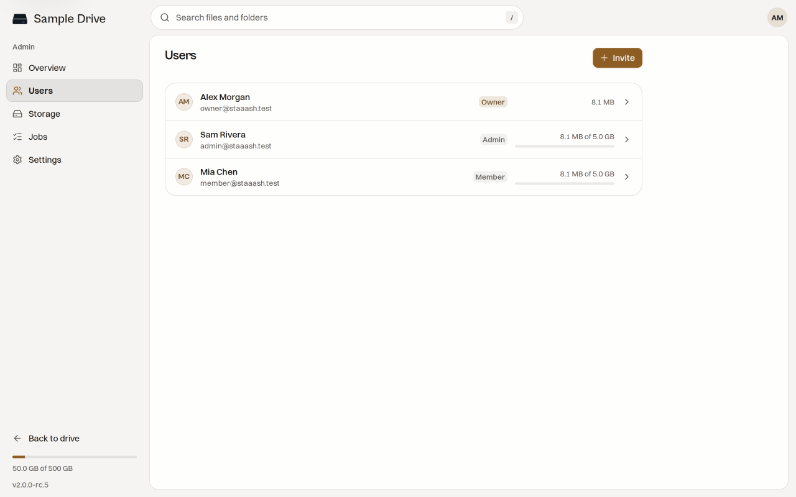

# User Management

You decide who can use your drive. This page is for the owner.

## The roles

| Role   | What they can do                                                                                                                                                           |
| ------ | -------------------------------------------------------------------------------------------------------------------------------------------------------------------------- |
| Owner  | The account that set up the instance. Runs the admin area.                                                                                                                 |
| Admin  | A person the owner marked as "Can open the admin pages". In this release the admin screens and settings still ask for the owner, so treat this role as reserved for later. |
| Member | A normal person. Has their own files, shares and settings.                                                                                                                 |

Everyone has a private space. The owner cannot read a member's files by being the owner.

## Invite someone

1. Open **Admin**, then **Users**, then press **Invite**.
2. Type their email.
3. Optional: set a **Storage limit**. Leave it empty for no limit.
4. Pick a password. Either type one, or choose **Make up a password for me**.
5. Optional: turn on **Ask for a new password at sign-in**, so they pick their own after the first sign-in.
6. Optional: turn on **Can open the admin pages**.
7. Press **Invite**.

Staaash shows the sign-in address, the email and the password **once**. Copy it and send it to them with a way you trust. Staaash does not send email, so you must give it to them yourself.

## Change someone

Press a person in the list. You can change:

- their name and email
- their role
- their storage limit

## Storage limits

A limit stops a person from storing more than it. The list shows each person's use, for example "8.1 MB of 5.0 GB". Raise a limit any time. If you lower it below what they already use, they keep their files but cannot upload more until they free space.

## Reset a password

1. Press the person, then **Reset password** under **Signed in**.
2. Choose a new temporary password, or let Staaash make one.
3. Send it to them.

Resetting signs them out everywhere. You can also sign out a single device from the same screen.

## Sign-in time

By default people stay signed in for a while and then sign in again. Change the time under admin **Settings**, **Sessions**. See [[Configuration]].

## Removing a person

The admin screens have no button to delete an account. If someone should lose access today, reset their password and keep the new password to yourself. They are signed out everywhere. Ask in [GitHub Discussions](https://github.com/itsmeares/staaash/discussions) if you need the account fully removed.
