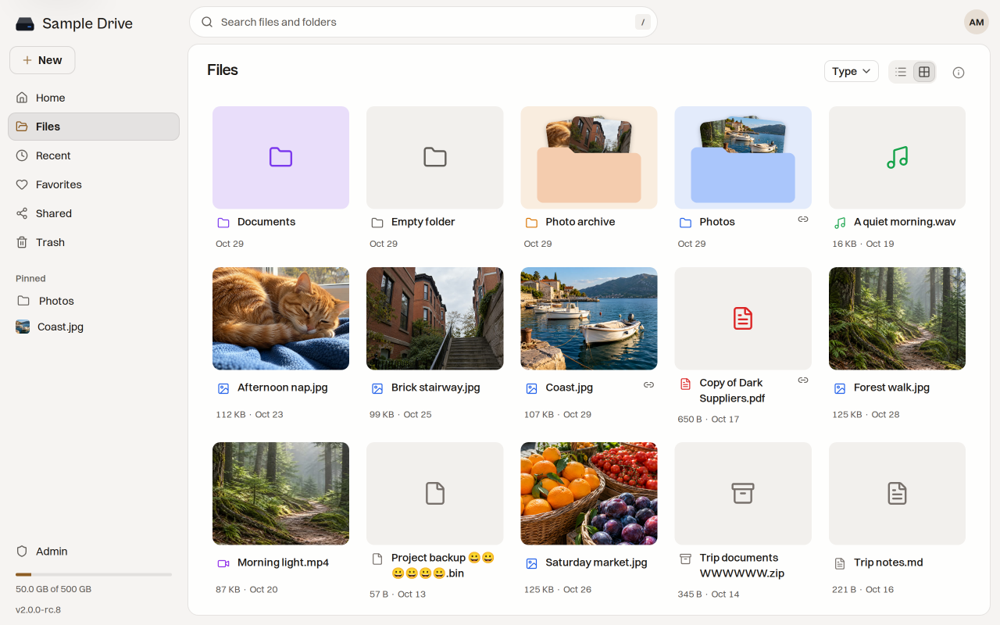

# Using the Drive

This page covers the everyday things: adding files, finding them, and getting them back.

The sidebar has **Home**, **Files**, **Recent**, **Favorites**, **Shared** and **Trash**. The bar at the bottom shows how much space you use.

## Add files

- Click **New**, then **Upload files** or **Upload folder**.
- Or drag files and folders from your computer onto the page.
- Or copy files on your computer and press `Ctrl+V` (`⌘V` on a Mac) in a folder.

Uploads show their progress while they run. Staaash checks every file after it arrives, so a broken upload never shows up as a file.

To make a folder, click **New**, then **New folder**.

## Work with files and folders

Click the **⋯** button on an item, or right-click it, to see what you can do:

- **Open**, **Download**, **Rename**, **Move…** and **Move to trash**.
- **Download as zip** for a folder.
- **Color** to give a folder a color.
- **Add to favorites**.
- **Share** to make a link. See [[Sharing Files]].
- **Details** to see the size, dates and where it lives.

You can also drag items onto a folder to move them. Select several items with `Ctrl` or `Shift` and a click, or drag across empty space. Press `?` to see every keyboard shortcut.

## Find things

- Press `/` or click the search box at the top. Search ignores capitals and accents, so `cafe` finds `Café`.
- **Recent** shows your latest files and activity.
- **Favorites** lists what you marked. Click **Pin** on a favorite to keep it in the sidebar.
- The list and grid buttons at the top of a page switch the view. **Type** shows only one kind of file, like photos or PDFs.

## Look at files

Click a file to open it. Photos, videos, music, PDFs and text files open right in the browser. Use the arrow keys to go to the next file in the folder.

## Get things back

**Move to trash** does not delete a file. It waits in **Trash**, which shows how many days are left before it goes for good. That is 30 days unless your owner changed it.

- Click **Restore** to put an item back where it was.
- Click **Delete forever** on a file to remove it now.
- **Empty trash** removes everything in the trash, folders too. It is on the Trash page and in **Settings → Storage**.

Your settings live in [[Your Account]].
