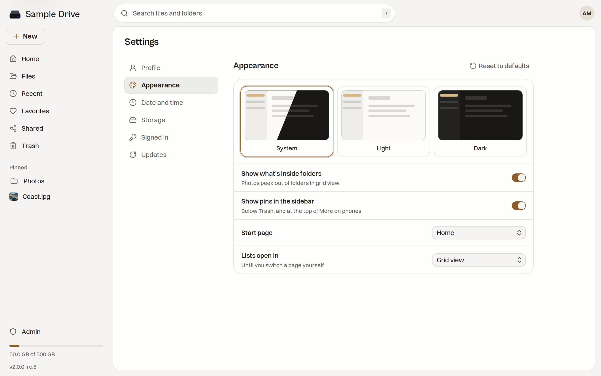

# Your Account

Click your picture in the top right corner, then **Settings**. The same menu has **Keyboard shortcuts**, **Get the desktop app** and **Sign out**.

Changes in Appearance and Date and time wait for you to press **Save**. **Reset to defaults** puts a group back the way it started.

## Profile

- **Edit** changes your name and photo. **Upload photo** picks a picture, and **Remove photo** goes back to your initials.
- **Change** next to **Password** sets a new password of at least 12 characters. All your other devices are signed out when you do.
- **Role** shows whether you are the owner or a member.

Your email address is your sign-in name. Only the owner can change it, in **Admin → Users**.

## Appearance

- **System**, **Light** or **Dark**. System follows your computer.
- **Show what's inside folders** lets photos peek out of folders in grid view.
- **Show pins in the sidebar** shows the items you pinned from **Favorites**.
- **Start page** is **Home** or **Files**.
- **Lists open in** picks list or grid view for pages you have not switched yourself.

## Date and time

- **Time zone** sets the zone for the dates and times you see. **Automatic** follows your browser.
- **Clock** is **24-hour** or **12-hour**.

## Storage

Shows how much space you use, split into photos, videos, music, documents and trash. If the owner gave you a limit, it shows that too.

- **Empty trash** removes everything in your trash for good.
- **Share links** counts your live links. **Manage** opens the **Shared** page.

## Signed in

Every browser and desktop app signed in to your account, with when it was last seen. **This browser** marks the one you are using.

- **Sign out** next to a device ends that one.
- **Sign out everywhere else** ends all of them except this browser.
- Each one shows the network address it last used.

Sign out a lost phone or computer here. To add the desktop app, see [[Desktop App]].

## Updates

Only the owner sees this. **Tell me about new versions** shows a note in the sidebar and a short announcement when a new Staaash version is out. To install it, see [[Updating]].
